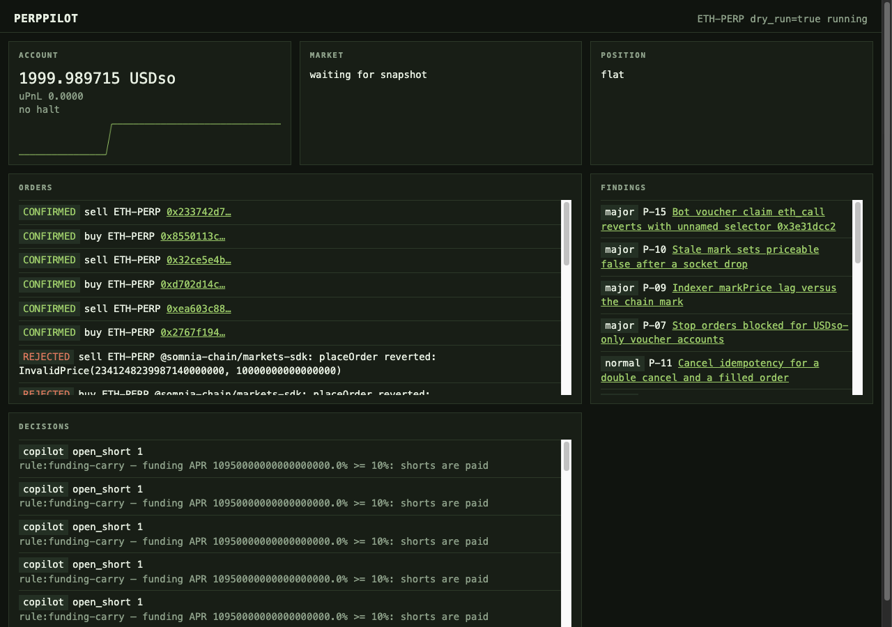

# PerpPilot

PerpPilot — an autonomous AI trading agent for dreamDEX perps on Somnia Tokyo testnet, with a live operator dashboard and a self-generated bug-report harness.

## What it does

- Trades ETH-PERP only after a deterministic risk kernel approves the order. Caps cover notional, leverage, open orders, a 50 bps price band, and a daily loss limit.
- Asks an optional LLM copilot for one action, and falls back to funding-carry and EMA rules when the key is blank or the call exceeds 4 seconds.
- Runs a software take-profit / stop-loss guard that closes the full position quantity and then halts.
- Writes every order with its transaction hash and an explorer link.
- Ships a feedback harness. Each report says whether it reached the documented case.

## Who it is for

Operator Olive wants a testnet agent that trades inside limits she can read, with a dashboard that shows the mark, the position, and why the last decision happened. She runs a dry loop first, then a timed live loop, and checks the halt after the guard flattens the account.

Integrator Devraj is wiring the same perps SDK and needs the failures written down: decimal scaling, indexer lag, voucher claim, and the missing reduce-only order entry. The `feedback/` reports are the reproducible notes, each with the SDK version and the chain id.

## How to run it

Requirements: Node 20+, npm 10+.

```bash
npm i
cp .env.example .env
npm run wallet:new
```

Fund the bot address with STT for gas. The public faucet at https://testnet.somnia.network/ pays Shannon (chain 50312), not Tokyo (chain 50383). Gas for this project came from the dreamDEX app bot-link top-up. See `docs/wallet-setup.md`.

```bash
npm run doctor
DRY_RUN=false npm run claim
npm run demo:dry
npm run dashboard
```

The dashboard listens on `http://127.0.0.1:8787`.

Live loop, at most 30 minutes:

```bash
DRY_RUN=false npm run demo:live -- --minutes 30
```

`npm run demo:live` already passes `--minutes 30`. The extra flag is ignored because the script reads the first `--minutes`. To run a shorter loop, call the script directly:

```bash
DRY_RUN=false npx tsx scripts/trade.ts --live --minutes 4
```

Leave `OWNER_ADDRESS` set to the funded perps account. The bot key sends `placeOrderFor` for that owner. Fills and PnL land on the owner, not on the bot. `DRY_RUN=true` refuses every broadcast.

`npm run claim` simulates a voucher claim for the bot key. On 2026-10-29 that eth_call reverted with an unnamed selector (`feedback/P15-unnamed-claim-revert-selector.md`). Nothing was broadcast. The live account is the already-funded owner.

## Live evidence

Full table: [docs/EVIDENCE.md](docs/EVIDENCE.md).

Corrected-loop close on 2026-10-29, owner position flat afterward:

- Open: https://explorer.testnet.somnia.network/tokyo/tx/0x14a0a92cd8c1ca9a82b0e5b56770e97880e0bb872a9416d2c9dc5e7986a4c3cc
- Close: https://explorer.testnet.somnia.network/tokyo/tx/0x038f9ae1605c7641926203fed8e9e9569876a801bbd24e98c199fc6240d63dc6



## Feedback track

Reached means the report hit the documented case. `partial` means an earlier leg is kept and the new leg still does not match the doc's expected revert name. `no` means the documented case did not occur.

| Report | Severity | Summary |
| --- | --- | --- |
| [P-01](feedback/P01-perp-order-wrong-decimals-misleads-insufficient-collateral.md) | major | 6-decimal quantity reverts `InvalidQuantity`, not `InsufficientCollateral`. Over-margin owner order also reverted. |
| [P-02](feedback/P02-perp-limit-price-zero-is-literal-price.md) | normal | A zero limit price is rejected before send. |
| [P-03](feedback/P03-ioc-unfilled-reverts-immediateorcancelnofill.md) | major | An IOC under the touch reverts `ImmediateOrCancelNoFill()`. |
| [P-04](feedback/P04-off-tick-price-and-non-lot-quantity-error-quality.md) | normal | An off-tick price reverts `InvalidPrice`. |
| [P-05](feedback/P05-getmaxperpordersize-vs-onchain-cap-divergence.md) | normal | The funded owner has a non-zero max. A minimum-quantity bid was accepted. |
| [P-06](feedback/P06-maxpositionsizesexceeded-error-surface.md) | major | An owner order above `maxPositionSize` reverted. The named selector was not in the message. |
| [P-07](feedback/P07-stop-orders-blocked-for-usdso-only-voucher-accounts.md) | major | ETH-PERP has a stop registry on the SDK row. The trader did not broadcast without a configured operator registry. |
| [P-08](feedback/P08-voucher-claim-blocked-markets-limitedby.md) | normal | `limitedBy collateral` masks `voucherBlocked` on both the bot and the owner. |
| [P-09](feedback/P09-indexer-markprice-lag-vs-chain-mark.md) | major | The indexer mark lagged the chain mark by about 2.46 USDso for five minutes. |
| [P-10](feedback/P10-stale-mark-priceable-false-after-ws-outage.md) | normal | No `priceable: false` in a two-minute sample. Closing the SDK socket is not a stale mark. |
| [P-11](feedback/P11-cancel-idempotency-double-cancel-and-cancel-filled.md) | normal | A real order id cancelled once. The second cancel reverted `IncorrectSender`. |
| [P-12](feedback/P12-tokyo-hideki-shannon-network-naming-and-faucet-gap.md) | major | Tokyo, hidekiTestnet, and Shannon are documented as different networks. |
| [P-13](feedback/P13-docs-imply-rest-for-perps-but-http-api-is-spot-only.md) | major | The HTTP API is spot-only. Perps use the SDK and the GraphQL indexer. |
| [P-14](feedback/P14-bot-kit-perp-core-pins-caret-0-31-never-gets-0-32.md) | normal | bot-kit perp-core pins `@somnia-chain/markets-sdk` to `^0.31.0`. |
| [P-15](feedback/P15-unnamed-claim-revert-selector.md) | major | Bot voucher eligibility says yes. `claim()` eth_call reverts with an unnamed selector. |
| [P-16](feedback/P16-funding-rate-integer-scale.md) | normal | The funding page shows decimal fractions. The SDK rate is a 1e18 fixed-point number. |

## Architecture

Prices come from the chain mark (`getPerpHealthSnapshot`) and the on-chain book. The GraphQL mark is only a lag check. Account equity and position size are read from the owner margin account. Momentum uses 9 and 21 one-minute closes and stays flat until 21 closes exist.

```
             ┌──────────────────────── 2s tick (orchestrator) ─────────────────────────┐
             │                                                                          │
  WS RPC ───►│ MarketDataAgent ──MarketSnapshot──► SignalsAgent ──Signal[]──┐           │
  GraphQL ──►│        │                                                     ▼           │
             │        │                                        CopilotAgent (LLM advisory)│
             │        │                                                     │           │
             │        ▼                                                     ▼           │
             │   GuardAgent ◄──positions── RiskAgent ◄──OrderIntent─────────┘           │
             │   (TP/SL,        (vetoes)      │approved                                 │
             │   loss cap)                    ▼                                         │
             │                          ExecutionAgent ──tx──► Somnia Tokyo (50383)     │
             │                                │        │                               │
             │                                ▼        └─►tx hash → explorer link       │
             │                          ReporterAgent ──► findings db ──► feedback/*.md │
             └──────────────────────────────────────────────────────────────────────────┘
                                  all envelopes ──► runs/*.jsonl + dashboard ws push
```

| Agent | Role | Tools / inputs | Outputs |
|---|---|---|---|
| Orchestrator | 2s tick. Halt is read back from the database on startup. | bus, kv | tick envelopes, halt |
| MarketDataAgent | Chain mark, book tops, indexer lag | `getPerpHealthSnapshot`, `getBookTopsOnchain`, GraphQL | `MarketSnapshot` |
| SignalsAgent | Funding-carry and EMA(9/21) on 1-minute closes | snapshot | `Signal[]` |
| CopilotAgent | One legal action, or the rule fallback | snapshot, signals, optional Anthropic SDK | `Decision` |
| RiskAgent | Deterministic veto | intent, caps, snapshot | `RiskVerdict` |
| ExecutionAgent | The only signer. Dry-run never broadcasts. Linked owner uses `placeOrderFor` / `cancelOrderFor`. | viem, SDK trader when no owner is set | `ExecutionReport` |
| GuardAgent | Full-quantity TP/SL and daily-loss close, then halt | on-chain position | reduce-only intent |
| ReporterAgent | One feedback file per rejection class per day | bus | `feedback/auto-*.md` |

## Integration notes

- The SDK constructor needs a WebSocket RPC. HTTP alone fails the genesis check. Source: https://app.dreamdex.io/docs/developers/perps-testnet
- Base decimals differ by market. A 6-decimal ETH quantity reverts `InvalidQuantity`, not `InsufficientCollateral`. Source: https://app.dreamdex.io/docs/trading/perps-testnet/orders
- A mined transaction can still be a rejected order. Check the receipt events, not only status `success`. Source: https://github.com/somnia-chain/dreamdex-bot-kit/blob/main/docs/gotchas.md
- ETH-PERP's stop registry is on the market row. The trader still requires a separate operator-permissions registry, and the contract-addresses page does not list Tokyo. Source: https://app.dreamdex.io/docs/developers/contracts/contract-addresses
- Funding is quoted per 8-hour window and settled hourly: payment = size × index × rate / 8. The integer in GraphQL is 1e18-scaled (`FUNDING_PRECISION`). The 2026-10-29 ETH rate `1e14` is 10.95% APR. Source: https://app.dreamdex.io/docs/trading/perps-testnet/funding

## Using Somnia primitives

PerpPilot does not run as a Somnia Agent and does not subscribe to Somnia Reactivity. Market and account state are SDK reads over the Tokyo WebSocket RPC. Order placement for the linked owner is a viem transaction (`placeOrderFor` / `cancelOrderFor`) signed by the bot key. Fills are taken from the transaction receipt. The local bus that feeds the dashboard is process memory plus a JSONL file, not a chain subscription.
